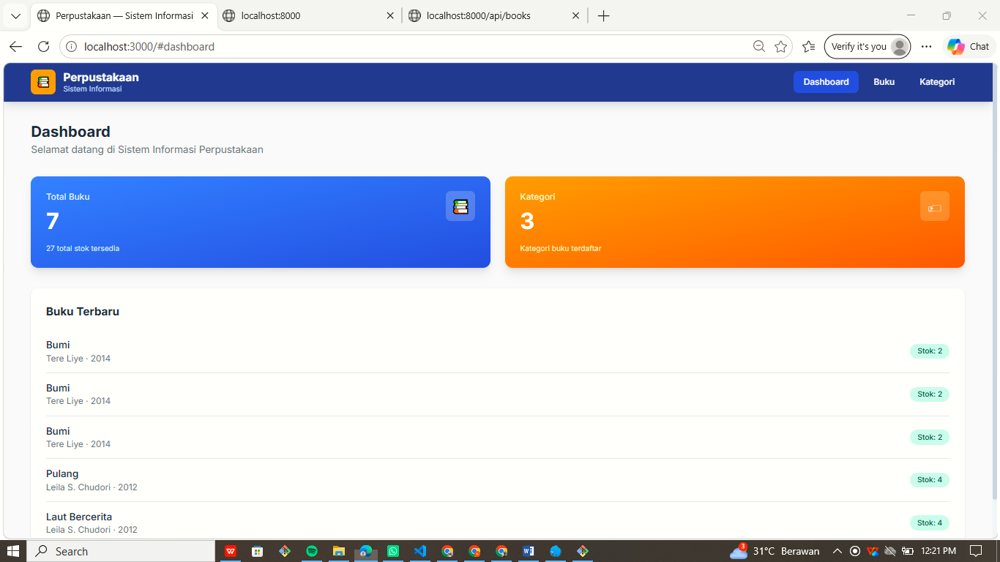
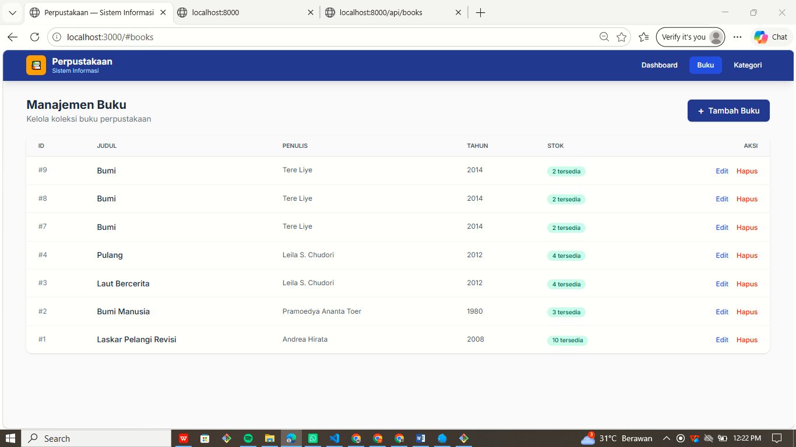
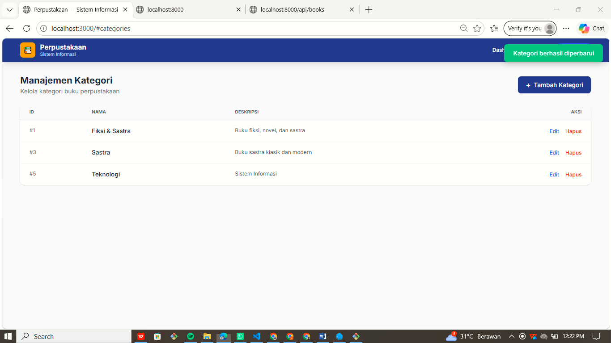

# PBO LKS - Portofolio Praktikum

Nama  : Nabila Pracita Ramadanti
NIM   : H1101251040
Kelas : PBO B

## Daftar Pertemuan
-	[ ] Pertemuan 1 - Setup & Database
-	[ ] Pertemuan 2 - Core OOP
-	[ ] Pertemuan 3 - Framework & Routing
-	[ ] Pertemuan 4 - Testing Backend
-	[ ] Pertemuan 5 - CRUD Kategori
-	[ ] Pertemuan 6 - Frontend
-	[ ] Pertemuan 7 - Integrasi & Finalisasi

## Dokumentasi Screenshot Tiap Pertemuan

- [Pertemuan 01](pertemuan-01/langkah-01.png)
- [Pertemuan 01](pertemuan-01/langkah-02.png)
- [Pertemuan 01](pertemuan-01/langkah-03.png)
- [Pertemuan 01](pertemuan-01/langkah-04.png)
- [Pertemuan 01](pertemuan-01/langkah-05.png)
- [Pertemuan 02](pertemuan-02/langkah-06.png)
- [Pertemuan 02](pertemuan-02/langkah-07.png)
- [Pertemuan 02](pertemuan-02/langkah-08.png)
- [Pertemuan 02](pertemuan-02/langkah-09(1).png)
- [Pertemuan 02](pertemuan-02/langkah-09(2).png)
- [Pertemuan 02](pertemuan-02/langkah-09(3).png)
- [Pertemuan 02](pertemuan-02/langkah-09(4).png)
- [Pertemuan 03](pertemuan-03/langkah-10.png)
- [Pertemuan 03](pertemuan-03/langkah-11.png)
- [Pertemuan 04](pertemuan-04/langkah-12(1).png)
- [Pertemuan 04](pertemuan-04/langkah-12(2).png)
- [Pertemuan 05](pertemuan-05/langkah-13.png)
- [Pertemuan 05](pertemuan-05/langkah-14.png)
- [Pertemuan 05](pertemuan-05/langkah-15.png)
- [Pertemuan 06](pertemuan-06/langkah-16.png)
- [Pertemuan 06](pertemuan-06/langkah-17.png)
- [Pertemuan 06](pertemuan-06/langkah-18(1).png)
- [Pertemuan 06](pertemuan-06/langkah-18(2).png)
- [Pertemuan 07](pertemuan-07/langkah-19(1).png)
- [Pertemuan 07](pertemuan-07/langkah-19(2).png)
- [Pertemuan 07](pertemuan-07/langkah-19(3).png)

## Screenshot Aplikasi Final

### Dashboard

### Halaman Buku

### Halaman Kategori

## Fitur 
Aplikasi Sistem Informasi Perpustakaan memiliki beberapa fitur, yaitu:
1. Dashboard
   - Menampilkan jumlah total buku yang terdaftar.
   - Menampilkan jumlah kategori buku.
   - Menampilkan total stok buku.
   - Menampilkan 5 buku terbaru.
2. Manajemen Buku
   - Menampilkan daftar buku dalam bentuk tabel.
   - Menampilkan informasi ID, judul, penulis, tahun, stok, dan aksi.
   - Tambah data buku.
   - Edit data buku.
   - Hapus data buku.
3. Manajemen Kategori
   - Menampilkan daftar kategori buku.
   - Menampilkan informasi ID, nama kategori, deskripsi, dan aksi.
   - Tambah kategori buku baru.
   - Edit kategori buku.
   - Hapus kategori buku.
4. Notifikasi
   - Menampilkan notifikasi ketika data berhasil ditambahkan, diperbarui, atau dihapus.
   - Menampilkan pesan kesalahan apabila proses tidak berhasil.
5. Integrasi REST API
   - Menghubungkan frontend dengan backend menggunakan Fetch API.
   - Menggunakan endpoint GET, POST, PUT, dan DELETE untuk proses pengelolaan data.
   - Menangani respons dan kesalahan dari API.

## Pastikan PHP dengan versi minimal 8.x.x sudah terpasang.
1. Persiapan
- Pastikan MySQL versi 8.x.x pada Laragon sudah berjalan.
- Pastikan composer versi 2.x.x sudah terpasang
- Pastikan database dan tabel yang digunakan oleh aplikasi sudah tersedia.
2. Menjalankan Backend
- Buka terminal pertama (PowerShell), kemudian masuk ke folder proyek:

"cd pertemuan-01/rest-api-perpustakaan"

- Jalankan server backend dengan perintah:

"php -S localhost:8000 -t public public/index.php"

Backend berjalan pada alamat:
http://localhost:8000

2. Menjalankan frontend
- Buka terminal kedua (PowerShell), kemudian masuk ke folder frontend:

"cd pertemuan-01/rest-api-perpustakaan/
frontend-perpustakaan"

- Jalankan server frontend:

"php -S localhost:3000"

3. Setelah backend dan frontend berhasil dijalankan, buka browser dan akses:
http://localhost:3000
Aplikasi Sistem Informasi Perpustakaan siap digunakan.